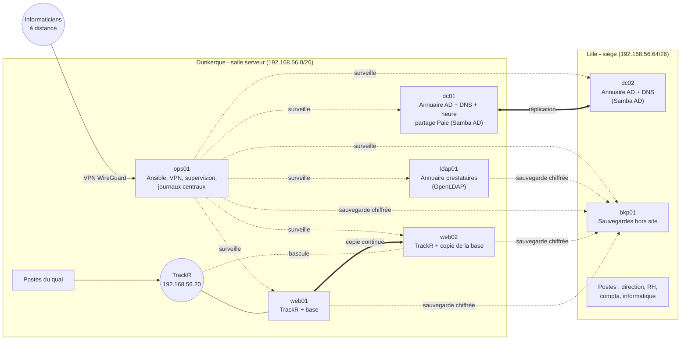

# Architecture

## Vue d'ensemble

## Les machines

| Machine | Site | Système | Rôle | Pourquoi là |
|---|---|---|---|---|
| dc01 | Dunkerque | Debian 12 + Samba AD | Active Directory, DNS, référence de l'heure, partage Paie | Les serveurs sont à Dunkerque ; le quai doit pouvoir se connecter même liaison coupée |
| dc02 | Lille | Debian 12 + Samba AD | Active Directory, DNS | Lille garde ses connexions si la liaison tombe ; second exemplaire de l'annuaire |
| ldap01 | Dunkerque | Debian 12 | Annuaire des prestataires (OpenLDAP) | Les prestataires n'entrent jamais dans l'annuaire interne |
| web01, web02 | Dunkerque | Debian 12 | TrackR (application + PostgreSQL + nginx), adresse flottante keepalived | Deux exemplaires : une panne d'un serveur ne bloque plus les camions |
| ops01 | Dunkerque | Debian 12 | Ansible, VPN WireGuard, bastion SSH, Prometheus/Alertmanager/Grafana, journaux centraux | Le « poste de pilotage » de l'infrastructure |
| bkp01 | Lille | Debian 12 | Sauvegardes (BorgBackup) | Hors du site des serveurs : un incendie à Dunkerque ne détruit pas les sauvegardes |

Taille en production (indicatif) : 2 Go de RAM par serveur suffisent.
Le labo tourne avec beaucoup moins (voir `hosts.yml`).

## Choix techniques et raisons

| Sujet | Choix | Raison | Alternative écartée |
|---|---|---|---|
| Automatisation | **Ansible** | Imposé ; lisible (YAML), sans agent, gère Linux et Windows | — |
| Annuaire des salariés | **Active Directory avec Samba AD** (Debian) | Compatible Windows : les PC du siège s'y joignent normalement et se gèrent avec les outils Microsoft (RSAT) ; un seul identifiant pour le PC, les serveurs Linux (realm join) et TrackR ; aucune licence ; 512 Mo de RAM par DC | Windows Server : ~1 000 € par serveur + licences d'accès, 4 fois plus de ressources ; essayé dans le labo puis écarté |
| Annuaire des prestataires | **OpenLDAP** | Gratuit, léger ; séparation stricte : un prestataire n'a aucun compte dans l'AD | Comptes invités dans l'AD : risque d'accès trop large |
| Haute disponibilité TrackR | **2 serveurs + keepalived + réplication PostgreSQL** | Simple, gratuit, bascule en quelques secondes | Cluster Kubernetes/Patroni : trop complexe pour une équipe de 1-2 personnes |
| Saisie au quai | **File d'attente dans le navigateur** | Même si les 2 serveurs sont en panne, le quai continue ; aucune saisie perdue, aucun doublon (identifiant unique par saisie) | — |
| Sauvegardes | **BorgBackup**, chiffré, dédupliqué, en ajout seul, à Lille | Un pirate qui prend un serveur ne peut pas effacer les sauvegardes ; un sinistre à Dunkerque non plus | Copies sur le même site : perdues avec lui |
| Supervision | **Prometheus + Alertmanager + Grafana** | Standard, gratuit, alertes avant la panne (disque qui se remplit, certificat qui expire…) | Nagios/Zabbix : plus lourds à automatiser |
| Journaux | **rsyslog** centralisé + **auditd** | Inclus dans Debian ; les journaux sortent du serveur (un intrus ne peut pas les effacer) | ELK : trop gourmand pour ce budget |
| Accès distant | **WireGuard** + bastion SSH | Rapide, simple, un accès par personne, révocable | Ports ouverts sur Internet : interdit |
| Chiffrement interne | **Autorité de certification interne** gérée par Ansible | Tout est chiffré (LDAPS, HTTPS, SMB3) sans acheter de certificats | Certificats auto-signés : avertissements, pas de vérification |
| Secrets | **Ansible Vault** | Aucun mot de passe en clair dans le dépôt | — |
| Labo | **Vagrant + VirtualBox** | Le même dépôt crée le labo sur un PC portable | — |

## Flux réseau

| De | Vers | Port | Usage |
|---|---|---|---|
| Postes, quai | VIP TrackR | 443 | Application TrackR (HTTPS) |
| web01/web02 | dc01, dc02 | 636 | Connexion des salariés (LDAPS) |
| web01/web02 | ldap01 | 636 | Connexion des prestataires (LDAPS) |
| web01 ↔ web02 | | 5432, VRRP | Copie de la base, adresse flottante |
| Tous | dc01, dc02 | 53, 88, 123, 389 | DNS, Kerberos, heure, annuaire |
| Tous | ops01 | 514 | Journaux centralisés |
| ops01 | tous | 22, 9100 | Ansible, supervision |
| Tous (Linux) | bkp01 | 22 | Sauvegarde (clé SSH limitée à l'ajout) |
| Internet | ops01 | 51820/udp | VPN des informaticiens |

Tout le reste est refusé par le pare-feu de chaque serveur (nftables).

## Sécurité des accès

- **Un identifiant par personne**, dans l'AD, créé à partir du fichier des RH.
- **Groupes par service** (`GG_RH`, `GG_Quai`…) : les droits suivent le poste.
  Passer du quai aux bureaux = changer la colonne `service` → les groupes,
  l'unité d'organisation et les droits TrackR changent au prochain déploiement.
- **Départ** : statut `parti` → compte désactivé, retiré de tous les groupes,
  VPN supprimé.
- **Serveurs Linux** : seuls les membres de `GG_Admins_Linux` peuvent s'y connecter
  et utiliser `sudo` ; un compte local `secours` (mot de passe dans le coffre)
  sert si l'annuaire est hors service.
- **Paie** : seuls `GG_RH` et `GG_Direction` ; dossier fermé à tous sur le
  serveur ; partage invisible et chiffré (SMB3) ; chaque ouverture, modification,
  suppression et chaque refus sont journalisés avec le nom de la personne.
- **Prestataires** : ne lisent que leur propre fiche dans l'annuaire ;
  TrackR en lecture seule, sans le nom des salariés ; compte verrouillé à la
  date de fin (tâche quotidienne sur ldap01, indépendante d'Ansible).

## Coûts

| Poste | Coût |
|---|---|
| Tous les logiciels (Debian, Samba AD, PostgreSQL, OpenLDAP, Prometheus, Grafana, Borg, WireGuard, Ansible) | 0 € |
| Économie par rapport à 2 Windows Server | ~2 000 € + licences d'accès (CAL) |
| Matériel | 2 hyperviseurs (un par site) suffisent pour ces 7 VM |
| Disque de sauvegarde à Lille | ~200 € |

## Limites connues (et la suite)

- Le partage Paie est sur un contrôleur de domaine pour économiser une machine ;
  avec plus de budget, un serveur de fichiers dédié.
- La bascule TrackR est automatique, le **retour** se fait par une commande
  (`trackr-reconstruire-secours.yml`) : volontaire, pour éviter qu'un serveur
  revenant d'une panne n'écrase des données récentes.
- Samba AD ne réplique pas automatiquement le dossier SYSVOL (stratégies de groupe)
  entre DC : si on utilise des GPO, les recopier (rsync) ou les déployer par Ansible.
- Les comptes « vagrant » n'existent que dans le labo.
